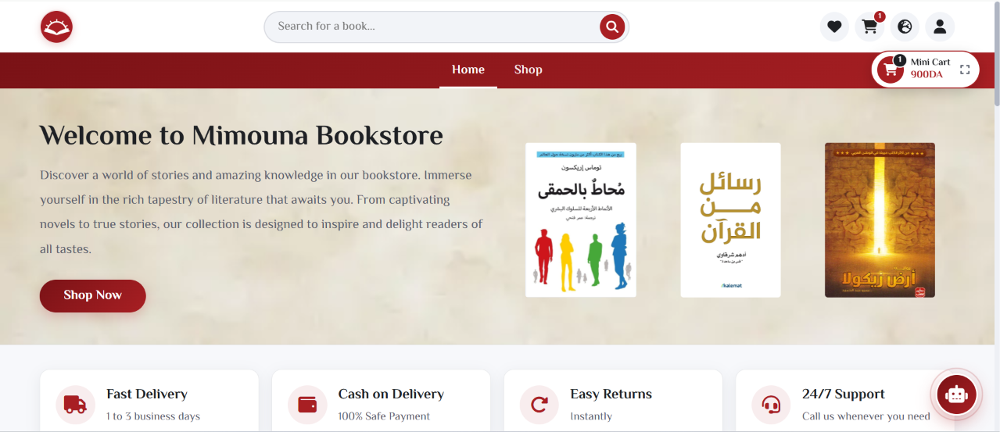
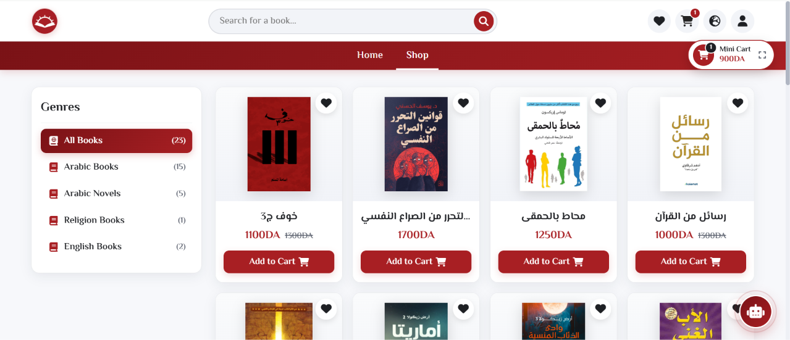
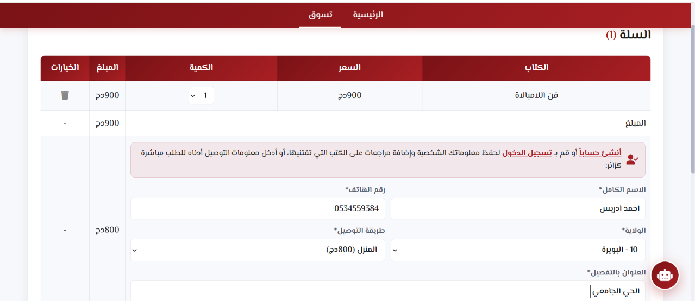
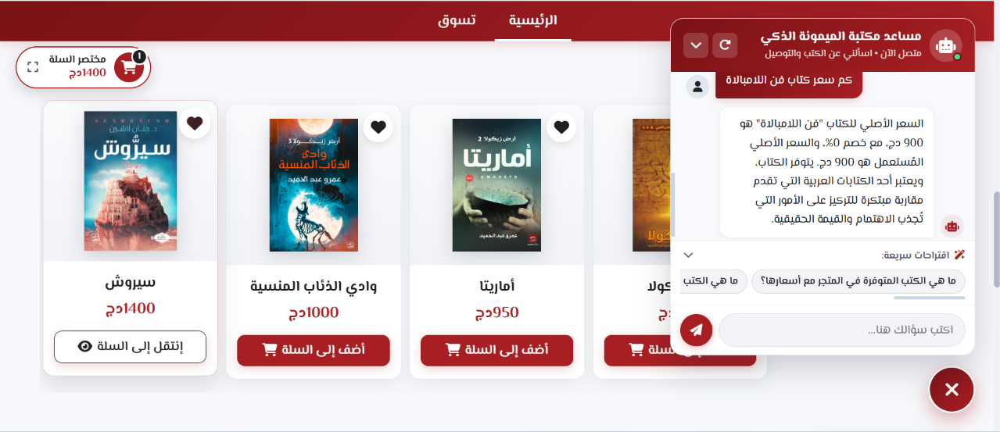
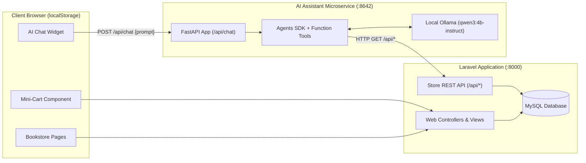

# Mimouna Bookstore

Mimouna Bookstore is a multilingual online bookstore and e-commerce web application built with Laravel 11, featuring an interactive frontend and an integrated AI Shopping Assistant powered by Python, FastAPI, OpenAI Agents SDK, and local Ollama (qwen3:4b-instruct).



---

## 1. Project Overview & Features

Mimouna Bookstore provides an end-to-end digital book-shopping experience for readers and store administrators. The application supports Arabic, French, and English with RTL/LTR layout adaptation, covering book browsing, community reviews, cart management, Wilaya-based shipping calculation across Algeria, and order fulfillment.

### Customer Features
- Storefront & Discovery: Featured bookshelf slider, bestsellers, novel highlights, and newly added books.
- Shop Catalog: Keyword search, genre filtering, and paginated book listings.
- Cart Management: Real-time client-side cart synchronized with a collapsible mini-cart component.
- Checkout: Order placement for registered users and guest visitors, with automatic delivery fee calculation for Stop Desk and A Domicile across 58 Wilayas.
- Reviews & Wishlist: Book reviews, community upvotes, and personal wishlist management.
- User Account: Profile editing, delivery address management, and order history tracking.





### Administrator Features
- Books & Genres: CRUD operations for books, cover image uploads, pricing, discounts, stock levels, and multilingual categories.
- Orders Dashboard: Order tracking, status updates (Pending, Confirmed, Shipped, Delivered, Cancelled), and automatic inventory adjustments.
- Delivery Tariffs: Wilaya activation toggle and custom shipping rates for office and home delivery.
- Moderation: Customer review approval, removal, and user account management.

---

## 2. Integrated AI Shopping Assistant

The bookstore includes an AI assistant accessible from public pages through a floating chat button.



### Architecture & Operation
- Interactive Chat Widget: Floating interface supporting prompt suggestions, typing status, local chat reset, and multilingual direction (RTL/LTR).
- Client-Side Chat Persistence: Conversation messages are saved locally in the browser (localStorage) across page navigation, and starting a new conversation clears the local chat history directly without server-side session storage.
- AI Microservice (ai_assistant/): Stateless FastAPI application running on port 8642 with OpenAI Agents SDK and local Ollama (qwen3:4b-instruct).
- Backend Grounding Tools: Real-time queries to Laravel API endpoints:
  - GET /api/books: Book catalog, prices, discounts, availability, and descriptions.
  - GET /api/regions: Delivery availability and shipping rates per Wilaya.
  - GET /api/genres: Categories and categorized book listings.
  - GET /api/books/{bookId}/reviews: Reader reviews sorted by upvotes.

---

## 3. Technology Stack

### Web Application (Main Bookstore)

| Layer | Technologies Used |
| :--- | :--- |
| Backend Framework | PHP 8.2+, Laravel 11 (Eloquent ORM, Form Requests, Blade Components) |
| Database | MySQL 8.0 / MariaDB |
| Frontend | Blade Templates, Custom CSS3, Vanilla JavaScript (ES6+) |
| Localization | Laravel Localization (ar, fr, en) with cookie persistence |
| REST API | Laravel API routes (routes/api.php) serving the AI service |

### AI Assistant Microservice (ai_assistant/)

| Layer | Technologies Used |
| :--- | :--- |
| Language & Runtime | Python 3.11+ |
| Web Framework | FastAPI, Uvicorn (ASGI server on port 8642) |
| Agent Orchestration | OpenAI Agents SDK (openai-agents) |
| Local LLM | Ollama running qwen3:4b-instruct |
| HTTP Client & Validation | HTTPX, Pydantic v2, Pydantic Settings |

---

## 4. Architecture Overview



---

## 5. Getting Started

### Prerequisites
- Docker & Docker Compose, OR:
  - PHP >= 8.2, Composer, MySQL (e.g. XAMPP)
  - Node.js >= 18, npm
  - Python >= 3.11
- Ollama installed on the host machine:
  ```bash
  ollama pull qwen3:4b-instruct
  ```

---

### Option A: Running with Docker Compose (Recommended)

#### 1. Development Mode (Build from Source)
Starts MariaDB (auto-seeded via mimounabookstore_db.sql), Laravel 11, and Python AI Assistant:
```bash
docker compose -f docker-compose.dev.yml up -d --build
```

#### 2. Production Mode (Docker Hub Images)
Pulls and launches production images:
```bash
docker compose -f docker-compose.prod.yml up -d
```

To stop containers:
```bash
docker compose -f docker-compose.dev.yml down
```

---

### Option B: Manual Local Setup

#### 1. Run the Laravel Bookstore Application
```bash
# Install PHP and JavaScript dependencies
composer install
npm install

# Setup environment configuration and application key
cp .env.example .env
php artisan key:generate

# Run database migrations and seed data
php artisan migrate --seed

# Start Laravel development server
php artisan serve
```

#### 2. Run the AI Assistant Service
```bash
cd ai_assistant

# Activate virtual environment (Windows PowerShell)
.venv\Scripts\Activate.ps1

# Install Python dependencies
pip install -r requirements.txt

# Start FastAPI server
python main.py
```

Once running, access the application on localhost port 8000 (127.0.0.1:8000).

---

## 6. Code Quality & CI / CD (GitHub Actions)

Automated linting and syntax checks run on every push and pull_request via .github/workflows/lint.yml:

```bash
# PHP / Laravel:
./vendor/bin/pint --test

# Python (ai_assistant/):
ruff check ai_assistant/

# JavaScript:
npm run lint:js
```
